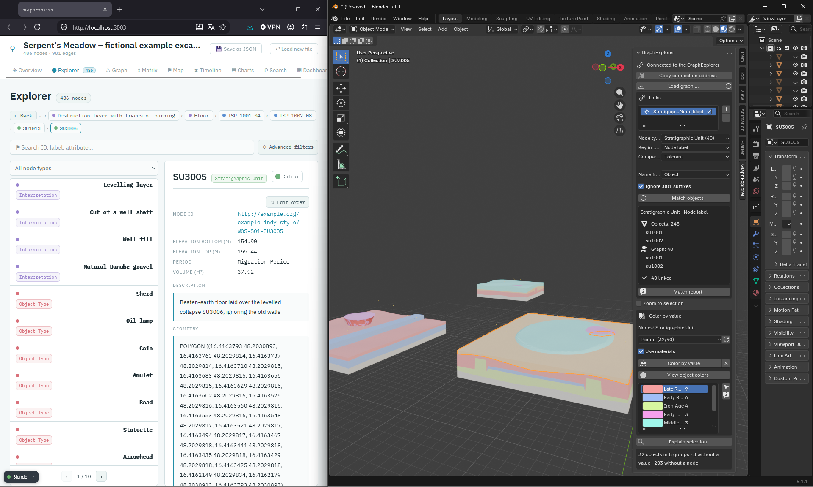
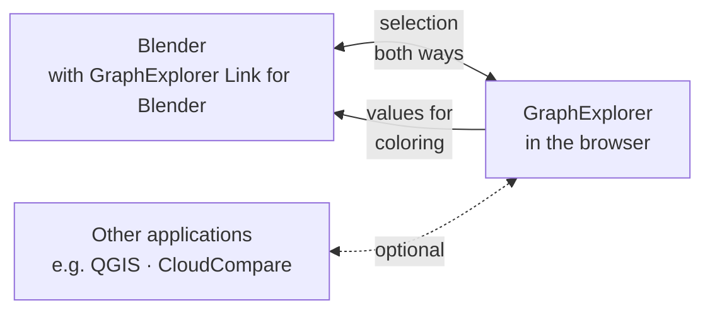
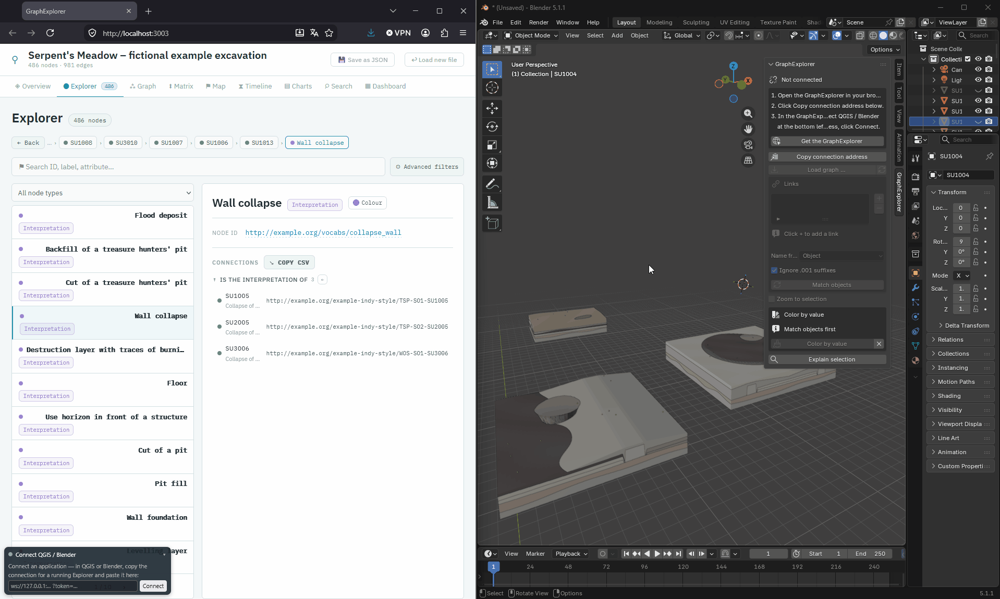
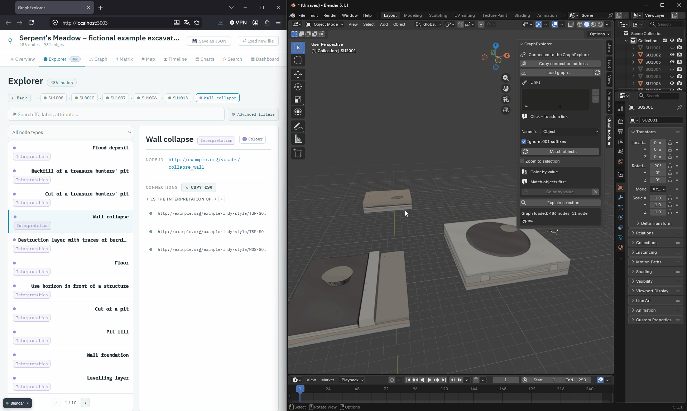
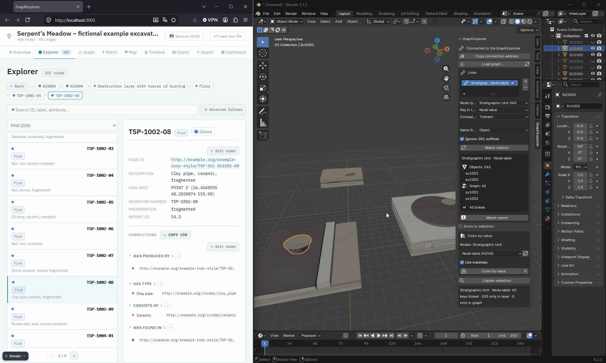

<p align="center">
  <br>
  <strong>GraphExplorer Link for Blender — your 3D model and your knowledge graph, side by side and in sync.</strong><br>
  Click an object in Blender and the <a href="https://github.com/oeai-dac/GraphExplorer">GraphExplorer</a> shows everything the graph knows about it.<br>
  Click something in the GraphExplorer and the matching objects are selected in Blender.<br>
  Color your model by any value from the graph.<br>
  No server, no extra software, and your data never leaves your computer.
</p>

<p align="center">
  
  
  
</p>

<p align="center">
  
</p>

---

## What does it do?

Excavation data usually lives in several places — this extension connects two of them:

- the **3D models** in Blender — e.g. a body for each stratigraphic unit, a marker for each find;
- the **knowledge** in a knowledge graph — e.g. what a unit contains, what lies above it, how it is dated, what a find is made of.

**GraphExplorer Link for Blender** connects the two. All it needs is that your objects in Blender are named like the things in the graph — for example, the body of the stratigraphic unit *SU1001* is called `SU1001`. You tell the extension once which kind of nodes your objects belong to. From then on:

- **Click an object in Blender** → the GraphExplorer opens that unit, with all its finds, its dating and its neighbours in the stratigraphy.
- **Click on a linked node in the GraphExplorer** — in its lists, the Harris matrix or the timeline etc. → the linked objects are selected in Blender.
- **Color the model by a value from the graph** — for example by period, by interpretation or by the number of finds per unit — and see at a glance how the excavation is structured.

The graph itself is shown in the **[GraphExplorer](https://github.com/oeai-dac/GraphExplorer)**, a free tool that runs in your web browser. This extension connects Blender to it. The same GraphExplorer can be connected to other applications at the same time — such as QGIS or CloudCompare with **[GraphExplorer Link for QGIS](https://github.com/oeai-dac/GraphExplorer_QGIS)** and **[GraphExplorer Link for CloudCompare](https://github.com/oeai-dac/GraphExplorer_CloudCompare)** — so a click in one program updates all the others.



> **New to knowledge graphs?** The [GraphExplorer README](https://github.com/oeai-dac/GraphExplorer#new-to-knowledge-graphs) explains the few terms you need — *node*, *connection*, *attribute* — in plain words.

### Features

- **Selection in both directions** — model → graph and graph → model, live
- **Works with your object names** — matched against the name, a property or the ID of the nodes
- **Forgiving matching** — ignores upper/lower case, extra spaces and the `.001` Blender adds to duplicate names; can also match `SE 2001` with `2001`, or pick the number out of names like `T2_SE2004`
- **Several links side by side** — e.g. one for the bodies of the units and one for the find markers
- **Match report** — shows which names appear in both, which only in Blender and which only in the graph
- **Clever selection** — click a find in the GraphExplorer, and Blender selects the unit it was found in
- **Color by value** — properties of the nodes, but also what is connected to them: the interpretation of a unit, the number of its finds, their material
- **Safe** — your own materials are never overwritten, and every coloring can be removed with one click
- **Saved with your .blend file** — links and the coloring legend travel with the file
- **Blender 4.2 and newer**, including Blender 5

---

## Installation

### What you need

- **Blender 4.2 or newer** (Blender 5 works too)
- The **[GraphExplorer](https://github.com/oeai-dac/GraphExplorer#installation)** — installed, or simply its single standalone HTML file. The extension does not include its own copy: it connects to the GraphExplorer you already use. When you update the GraphExplorer, Blender benefits straight away.

### Install the extension

**From a ZIP file:** download `graphexplorer_link-<version>.zip` from the [Releases](https://github.com/oeai-dac/GraphExplorer_Blender/releases) page. In Blender, open *Edit → Preferences → Get Extensions*, click the small arrow at the top right, choose *Install from Disk…* and select the file. (You can also simply drag the ZIP file into the Blender window.)

**From Blender** (once published on [extensions.blender.org](https://extensions.blender.org)): *Edit → Preferences → Get Extensions*, search for **GraphExplorer Link for Blender**, click *Install*.

After installing, you will find the tab **GraphExplorer** in the sidebar of the 3D Viewport. Press `N` to show or hide the sidebar.

### Update and uninstall

Use *Edit → Preferences → Add-ons* as for any other extension. Your links are saved in your `.blend` files, not in the extension, so they are kept when you update or reinstall.

---

## User Guide

The GraphExplorer comes with a small, **entirely fictional** excavation, *Serpent's Meadow*: two sites, three sondages, 40 stratigraphic units and 203 finds. The same excavation is available as a knowledge graph and as a 3D model, so you can try everything in a few minutes. The files are in the folder `0_exampleData/` of the GraphExplorer. This guide uses them throughout.

### 1. Open the graph in the GraphExplorer

[Start the GraphExplorer](https://github.com/oeai-dac/GraphExplorer#start) and drop `GraphExplorer_Example.json` onto its start page.

### 2. Open your models or the example data in Blender

Open your own `.blend` file — or, for the example, choose *File → Import → Wavefront (.obj)* and import `GraphExplorer_Example.obj` with the default settings. (Keep `GraphExplorer_Example.mtl` in the same folder; it holds the colors.)

The example model contains:

| Objects | Content |
|---|---|
| `SU1001` … `SU3014` | one body per stratigraphic unit, colored by its interpretation |
| `TSP-1001-01` … `WOS-3012-93` | one small marker per find |

Every object has the same name as its node in the graph: the body `SU1001` is the stratigraphic unit *SU1001* in the GraphExplorer, the marker `TSP-1001-01` is the find *TSP-1001-01*. That is all the extension needs.

### 3. Connect Blender and the GraphExplorer

In the 3D Viewport, press `N` to show the sidebar and click the tab **GraphExplorer**. A panel opens.

| Element | What it does |
|---|---|
| **Not connected / Connected to the GraphExplorer** | Shows whether the GraphExplorer is connected. While it is not, the panel shows the three steps to connect. |
| **Copy connection address** | Copies the address you paste into the GraphExplorer under *Connect application*. |
| **Load graph …** | Opens a graph JSON file in the connected GraphExplorer. Optional — you can also open the graph in the GraphExplorer itself. |
| **Links** | Sets up which nodes in the graph your objects belong to ([step 4](#4-link-the-objects-in-blender-with-the-nodes-in-the-graphexplorer)). |
| **Zoom to selection** | When something is selected in the GraphExplorer, the 3D view zooms to it. |
| **Color by value** | Colors the linked objects by a value from the graph ([step 5](#5-color-the-model-by-a-value-from-the-graph)). |
| **Explain selection** | Shows why a selected object is — or is not — linked ([see Troubleshooting](#troubleshooting)). |

To connect, click **Copy connection address**. Then, in the GraphExplorer, click **Connect application** at the bottom left, paste the address and click **Connect**.

The panel in Blender now says **Connected to the GraphExplorer**.



The connection address stays the same until you close Blender. If the connection drops — for example because you closed the browser tab — paste the same address again.

### 4. Link the Objects in Blender with the Nodes in the GraphExplorer

A **link** tells the extension: *the names of my objects* are the same as *the names of these nodes in the graph*. You can set up as many links as you need — in the example one for the bodies of the units and one for the find markers. Click **+** under *Links* to add a link, **−** to remove the selected one.

| Field | Meaning |
|---|---|
| **Node type** | Which nodes in the graph the objects belong to, e.g. *Stratigraphic Unit* |
| **Key in the graph** | Where the name is stored in the node: in the **node label** (the name shown in the GraphExplorer — the usual case), in a **node property** (choose it under *Property*) or in the **node ID** |
| **Comparison** | How strictly the names are compared ([see below](#when-the-names-are-written-differently)) |

**Example — link the stratigraphic units:** click **+** and fill in:

| Field | Choose |
|---|---|
| Node type | *Stratigraphic Unit* |
| Key in the graph | *Node label* |
| Comparison | *Tolerant* (the default) |

Click **Match objects**. Below the button, the panel shows examples of names from both sides — `SU1001`, `SU1002` … from Blender and from the graph — and the result: **40 linked**. Every body has found its unit.

**Example — link the finds as well:** click **+** again and set up the same for the finds: node type *Find*, key *Node label*. Click **Match objects** again: **203 linked**.



Node types and properties appear under the same names as in the GraphExplorer. Hover over an entry to see its full technical name.

A link can be switched off temporarily with its checkbox, without deleting it. The links are saved in the `.blend` file: when you open the file again and connect, they are matched again automatically.

#### Try it out

- **Blender → GraphExplorer:** click the body `SU1001` in Blender. The GraphExplorer opens *SU1001*: a flood deposit, lying above *SU1002*, with seven finds.
- **GraphExplorer → Blender:** in the GraphExplorer, click the find *TSP-1001-01* in the list of finds of *SU1001*. Blender selects its marker. The same works from the Harris matrix, the timeline and everywhere else in the GraphExplorer.
- **Clever selection:** switch off the link for the finds (untick its checkbox, then **Match objects**) and click another find of *SU1001*, e.g. *TSP-1001-02*. Now Blender selects the body of *SU1001*: if the clicked node itself has no object, the GraphExplorer looks at its neighbours (up to two steps away) and uses the nearest linked one — here the unit the find was found in.

Good to know:

- If several objects are selected, the GraphExplorer opens the first matching node — it always shows one node in detail.
- Clearing the selection in Blender leaves the node open in the GraphExplorer. That is intended.
- Hidden objects cannot be selected in Blender. If the GraphExplorer selects a unit whose body is hidden, nothing visible happens.

#### Check matches

Below **Match objects**, each link shows how many names were linked and examples from both sides — if nothing matches, you see at once how the names differ. **Match report** gives the details: which names exist on both sides, which **only in Blender** (listed as *only in layer*), which **only in the graph**, and where one name belongs to **several objects or nodes**.

Each link looks at all objects of the scene. So in the example, the link for the units lists the 203 find markers as *only in layer* — they belong to the other link — and the link for the finds lists the 40 bodies. Objects of Blender's default scene, like *Cube*, *Camera* and *Light*, appear there as well. That is no error.

The report is useful in its own right: *“12 bodies without a node in the graph, 3 nodes without a body”* tells you something about your data.

#### When the names are written differently

In the example, the names in Blender and in the graph are exactly the same. With your own data, they are often written slightly differently. Three settings help:

**Comparison** — choose for each link how strictly the names are compared:

| Comparison | What it does |
|---|---|
| **Tolerant** (default) | Upper/lower case and extra spaces do not matter: `SE  2001` matches `se 2001` |
| **Trim** | Only spaces at the beginning and end are ignored |
| **Exact** | Every character must match |
| **Digits only** | Only the number counts: `SE 2001` matches `2001`. Names with *several* numbers (`Trench 3, SE 2001`) are left out on purpose — guessing could connect a find with the wrong unit. |
| **Last number** | Takes the last number: `T2_SE2004` matches `2004` — useful when the trench is written in front |
| **Pattern** | A search pattern of your own (a regular expression); the part in brackets is compared. The default `SE[\s_-]*(\d+)` finds the number in `SE2004`, `SE 2004`, `SE-2004`, `se_2004` and `T2_SE2004` |

**Ignore .001 suffixes** (on by default, applies to all links) — Blender adds `.001`, `.002` to duplicate names. With this option, `SU1001.001` counts as `SU1001`, so a unit modelled in two parts lights up as a whole.

**Name from** (applies to all links) — compares the name of the **object** (default) or the name of its **mesh data**, in case only the mesh data carries the right name.

### 5. Color the Model by a Value from the Graph

The link shows model and graph side by side, one object at a time. Sometimes, though, you want to see **everything at once**: which units belong to which period, where the pits are, where most finds came from. **Color by value** colors all linked objects by a value from the graph — one color per value, with a legend.

**Example — color the units by period:**

1. In the list of links, select the link of the units: *Stratigraphic Unit · Node label*. The coloring always uses the selected link.
2. Under **Color by value**, open the list of values. It shows everything the units offer in the graph and on how many units it occurs. Choose **Period (32/40)** — 32 of the 40 units have a period.
3. Click **Color by value**.
4. The bodies are now colored by period, and a legend shows the eight periods from *Late Bronze Age* to *Modern* with the number of bodies in each. The status line at the bottom starts with *32 objects in 8 groups · 8 without a value*. The find markers are counted there as *without a node* — they belong to the other link and keep their color.



In the legend you can:

- **change a color** — click it and pick another; the model follows immediately;
- **select a group** — the arrow button selects all bodies of the selected group in Blender, and with them the node in the GraphExplorer;
- **explain the coloring** — the ⓘ button lists the groups and how many objects stayed without a color.

To go back to the original look, click **✕** next to *Color by value* (**Remove coloring**). The bodies get their own colors back.

**Example — color the units by the number of finds:** choose **→ contains find: count** and click **Color by value** again. Numbers are colored from blue (few finds) to red (many finds) — here from 0 to 14 finds per unit — so you see at once where most finds came from.

#### What you can color by

| In the list | Example from the example data |
|---|---|
| A **property** of the node | `Period`, `Elevation top (m)` |
| **Node label** / **Node ID** | every object its own color |
| **→ connection: count** | *→ contains find: count* — the number of finds in the unit |
| **→ connection: labels** | *→ has interpretation: labels* — `Flood deposit`, `Floor` … |
| **→ connection: property** | *→ contains find: Weight (g)* — the weights of the finds in the unit |

An arrow → means a connection going out from the node, ← one coming in. The last three rows are what makes the link worthwhile: this information is not stored in the unit itself but in what it is connected to.

#### When there is more than one value

- **Several values for one object** — a unit whose finds are made of bronze and of iron gets its own group `Bronze; Iron`, not half of *Bronze*.
- **Too many values** — a free-text description easily has 200 different values, and 200 colors cannot be told apart. From 24 groups on, the rarest values go into one grey group **… other**, and the legend says so.
- **Numbers** are sorted by size and colored from blue to red. If there are too many different numbers, they are combined into ranges such as `12–18`.

#### Coloring safely

A 3D model of an excavation is often made of textured meshes from photogrammetry, and their materials are valuable work. The coloring therefore **never overwrites your materials**:

- The coloring only lays its colors *over* your materials. Your own materials stay in the file, untouched.
- **Remove coloring** brings back exactly what was there before — also after saving and reopening the file, and also when the GraphExplorer is not connected.
- Every new coloring first removes the previous one, so no object keeps an old color by mistake.

Untick **Use materials** to change nothing about the materials at all: then only the *object color* is set, which Blender shows in the *Solid* view with *Color: Object*. The extension switches the view for you. The button **View object colors** does the same at any time — use it if the model stays grey although the legend shows colors.

### Several applications at the same time

The GraphExplorer can be connected to several applications at the same time — for example Blender, QGIS (with [GraphExplorer Link for QGIS](https://github.com/oeai-dac/GraphExplorer_QGIS)) and CloudCompare (with [GraphExplorer Link for CloudCompare](https://github.com/oeai-dac/GraphExplorer_CloudCompare)). Click the body of a unit in Blender, and the GraphExplorer opens the unit while QGIS selects its polygon — and the other way round. Copy the connection address in each program and paste them all into the GraphExplorer (*Connect application*, then *Connect another application*). The example data includes the matching GIS layers for QGIS, and the 3D model lines up with them.

### What is saved where

| What | Where |
|---|---|
| Links, *Name from*, the coloring legend, the folder of the last graph | In the **.blend file**. They belong to this model, so they travel with the file. The graph is never loaded automatically. |
| What an object looked like before coloring | On the **object** itself, until you remove the coloring |
| The graph | Only in the GraphExplorer in your browser — the extension does not store it |
| The connection address | Only while Blender is running |

---

## Troubleshooting

**The GraphExplorer shows “not connected” after pasting the address**
Each Blender session has its own address. If you have restarted Blender or switched the extension off and on, click **Copy connection address** again and paste the new address.

**Clicking in the GraphExplorer works, but clicking in Blender does nothing**
The extension has not found the graph side of the link — usually because *Key in the graph* does not fit, or because another graph was opened. Click **Match objects** and look at the examples from both sides.

**One particular object does not link**
Select it and click **Explain selection** at the bottom of the panel. It shows, for each link, the name that is compared and the node it leads to — or where it breaks off, with similar names from the graph. For example:

```
SU1001.001
· Name used for matching: 'SU1001'
· [Stratigraphic Unit · Node label] 'su1001' -> http://example.org/…/TSP-SO1-SU1001
· [Find · Node label] 'su1001' -> no node
```

**“No match — layer field and node key do not fit together”**
Compare the examples from both sides below **Match objects**. Often another **Comparison** (e.g. *Last number* or *Pattern*), another **Key in the graph** (*Node label* instead of a property) or **Name from** *Mesh data* solves it.

**The GraphExplorer selects something, but nothing happens in Blender**
The object may be hidden — hidden objects cannot be selected. Or the GraphExplorer already showed that node, in which case nothing changes.

**The model stays grey after coloring**
Click **View object colors**, or switch the viewport to *Material Preview*.

**“The GraphExplorer is older than this add-on”**
Update the GraphExplorer to the latest version.

**A second browser tab cannot connect**
Only one GraphExplorer can be connected to Blender at a time — otherwise two tabs would keep changing each other's selection. Close the other tab, or disconnect it with ✕ in its connection bar at the bottom left.

**Where are error messages?**
The last message is shown at the bottom of the panel. More details go to Blender's system console (*Window → Toggle System Console* on Windows). Messages from the GraphExplorer appear in the browser's developer console (F12).

---

## For developers

<details>
<summary><b>How it works: connection, protocol, security</b></summary>

### Why the GraphExplorer runs in the browser

Blender has no web view that could run the GraphExplorer, and its Python has no WebSocket library. So the extension runs a small WebSocket server of its own (`websocket.py`, Python standard library only) on `127.0.0.1`, and the GraphExplorer — the bridge is built into it (`src/explorer-bridge.js`) — connects to it. A WebSocket is always opened by the browser; the applications are the servers. This is also why several applications — such as Blender, QGIS and CloudCompare — can share one GraphExplorer without depending on each other.

### Threads and the timer

`bpy` is not thread-safe: calling `obj.select_set()` from a background thread leads to crashes that cannot be reproduced. The socket thread therefore never touches Blender. It puts incoming messages into a queue, and a timer (`bpy.app.timers`, every 200 ms) picks them up on the main thread:

```
socket thread          queue                  main thread (timer)
─────────────          ─────                  ───────────────────
reads frames    ──▶    ("message", …)   ──▶   bridge.poll() ──▶ bpy
```

Blender has no “selection changed” signal either. The same timer compares the current selection with the last one it saw — more robust than `depsgraph_update_post`, which fires on every movement in the viewport.

### Protocol

The same as the QGIS plugin — JSON in both directions, three forms:

```
Blender → Browser    {"id": 7, "method": "collectKeys", "args": [...]}
Browser → Blender    {"id": 7, "result": ...}
Browser → Blender    {"event": "selection", "nodeId": "...", "keys": [...]}
```

For the selection, Blender never sees node IDs, only keys (`SU1001`), so it needs to know nothing about the structure of the graph. The same goes for the coloring: `describeValues` says *which* values the nodes could provide, `collectValues` delivers them per key, and Blender decides which object gets which color.

```
Blender                                 GraphExplorer (browser)
─────────────────────────────────────────────────────────────────
timer: selection changed?
  → LinkIndex: object name → key
  → LinkIndex: key → node ID
  → {"method":"selectNodes"}  ───────▶  open the node

                                        selected node changes
                                          → resolve keys (up to 2 hops)
  {"event":"selection"}       ◀───────  send
  → LinkIndex: key → object names
  → obj.select_set()
```

### Interface version

On connecting, the GraphExplorer reports an interface version (`API_VERSION` in its `src/main.jsx`). The extension checks for **at least** the version it needs (currently 2; version 3 adds the display names), not for exactly that version: the bridge gains methods but never loses any, and since several applications can share one GraphExplorer, an equality check would turn every extension for one into a failure for the others.

### Access token

The server listens only on `127.0.0.1`, but “local” does not mean “only us”: any other program on the computer, and any web page in an open tab, could otherwise connect and read the loaded graph. Each Blender session therefore gets a random token. It is part of the copied address (`ws://127.0.0.1:<port>/?token=…`), and the GraphExplorer has to present it as its first message; anything else is refused. Treat the address like a password — it is only valid for the current Blender session. The port is only opened when **Copy connection address** is clicked for the first time, not when Blender starts.

### Feedback lock

Without a lock, the two sides would select each other endlessly. Because Blender's selection is compared rather than signalled, one marker is enough: when a selection from the GraphExplorer is set, the *actual* resulting selection is recorded as “last seen” — not the intended one, because `select_set()` silently does nothing on hidden objects.

### Safe coloring

The coloring switches each material slot of an object to `link = 'OBJECT'` and puts its own material (`GE_…`) there; the material in the mesh data stays untouched underneath. What was set before is stored on the object as the custom property `graphexplorer_shading`, so it survives saving, reloading and reinstalling. **Remove coloring** restores the slots from it and deletes the unused `GE_…` materials.

</details>

<details>
<summary><b>Install from source, project structure, tests</b></summary>

### Install from source

Build the extension ZIP with Blender's own tool and install it with *Install from Disk…*:

```bash
blender --command extension build --source-dir . --output-dir dist
#   writes dist/graphexplorer_link-<version>.zip
blender --command extension validate .
```

For development, you can instead link the repository into Blender's extension folder under the name `graphexplorer_link` and restart Blender after each change:

```bash
# Windows (as administrator, or with developer mode on)
mklink /D "%APPDATA%\Blender Foundation\Blender\<version>\extensions\user_default\graphexplorer_link" "C:\path\to\GraphExplorer_Blender"
# Linux:  ~/.config/blender/<version>/extensions/user_default/graphexplorer_link
# macOS:  ~/Library/Application Support/Blender/<version>/extensions/user_default/graphexplorer_link
```

### Project structure

```
GraphExplorer_Blender/
├── __init__.py              register/unregister
├── blender_manifest.toml    extension metadata for Blender 4.2+
├── addon.py                 settings, links, sidebar panel, operators, timer
├── objectsync.py            read object names, read/set the selection, feedback lock
├── bridge.py                protocol, access token (no bpy)
├── websocket.py             WebSocket server from the standard library (no bpy)
├── linking.py               the matching itself — identical to the QGIS plugin
├── coloring.py              groups and colors — no bpy, testable
├── shading.py               set and restore materials (touches the scene)
├── icon.png / icon.svg
└── tests/
    ├── _bpy_stub.py             a minimal bpy stand-in for the checks below
    ├── run-addon-checks.py      panel wiring, coloring and removing it again
    ├── run-coloring-checks.py   groups, ranges, colors, material names
    ├── run-linking-checks.py    matching (identical to the QGIS plugin)
    └── run-websocket-checks.py  handshake and frames
```

Only `addon.py`, `objectsync.py` and `shading.py` import `bpy`; everything else can be tested with plain Python. `linking.py` is kept character for character identical to the one in the QGIS plugin — Blender's `.001` suffix is handled in `objectsync.py` instead. Code comments are in German.

### Tests

```bash
python tests/run-websocket-checks.py
python tests/run-linking-checks.py
python tests/run-coloring-checks.py
python tests/run-addon-checks.py
```

`run-addon-checks.py` runs against `tests/_bpy_stub.py`: it checks the *wiring* — that the panel draws, that every button points to an operator that exists, and that removing a coloring brings back the original materials — not Blender itself. The browser side of the bridge is tested in the GraphExplorer repository (`npm run check`).

</details>

---

## License

GPL 3.0 or later — see [LICENSE](LICENSE).

---

## AI Assistance

GraphExplorer Link for Blender was developed with the AI coding assistant [Claude Code](https://claude.com/claude-code) by Anthropic. Claude was used to write and refactor code, to review it against the documentation, and to help with drafting the documentation. The concept, the requirements and the testing come from the author; every change was reviewed before it was adopted.

---

## Acknowledgments and Credits

Developed for digital archaeology and cultural heritage data management, as a companion to the [GraphExplorer](https://github.com/oeai-dac/GraphExplorer) and [OntoCartographer Studio](https://github.com/oeai-dac/OntoCartographer-Studio).
